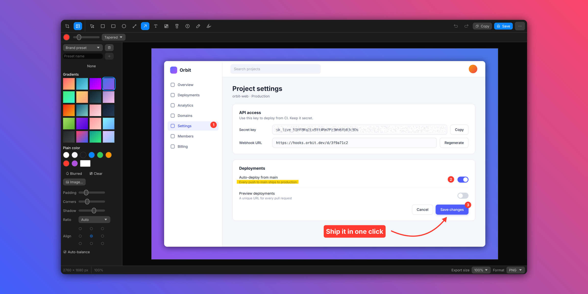

# ShotCraft

A cross-platform (Linux, Windows, macOS) screenshot tool in pure Rust.
The UI is egui/eframe; there is no webview.



## Features

| Feature | ShotCraft |
|---|---|
| One shortcut, every capture mode (All-In-One) | `all-in-one`: area, fullscreen, window, scrolling, timer and OCR from one bar, with resize handles, typed size and locked aspect ratio |
| Area, previous area, fullscreen, window capture | `capture-area`, `capture-previous-area`, `capture-fullscreen`, `capture-window` over a frozen screen, with crosshair and magnifier; windows can get a shadow or a background |
| Self-timer | `self-timer`: select, then a countdown beside the region |
| Annotate, redact and polish | Editor with arrow (4 styles, curved), rectangle, filled rectangle, ellipse, line, pen with smoothing, highlighter, text (7 styles), counter, spotlight, blur, pixelate and solid redaction, crop with aspect ratios, image drop-in, colour palette and picker |
| Background tool | Gradients, solid, image and blurred fills, padding, corner radius, shadow, aspect ratio, alignment, auto-balance, saved presets |
| Editable project files | `.shotcraft` (JSON with the base image and every annotation) |
| Scrolling capture | Stitches frames while you or auto-scroll move the content |
| Quick Access Overlay | Floating card after each capture: copy, save, annotate, pin, upload, OCR, or drag the file into another app |
| Text recognition | On-device OCR (ocrs); QR codes are read first |
| Pin screenshots | Always-on-top image with zoom, opacity (1 to 0 keys) and arrow-key nudging |
| Capture history | One month of captures with filters, restore, copy, save, annotate and pin |
| Upload and share a link | Multipart POST to an endpoint you configure; the link from the response is copied |

Not covered: hosted cloud sharing with comment threads, screen recording, and hiding desktop icons.

## Commands

Every mode is a subcommand of one binary (`shotcraft capture-area`), so any of them can be bound to an OS shortcut.
Running `shotcraft` with no subcommand starts the tray daemon with global shortcuts.

| Command | Options |
|---|---|
| `all-in-one` | `--x --y --width --height --display` |
| `capture-area` | `--x --y --width --height --display --action copy\|save\|annotate\|upload` |
| `capture-previous-area` | `--action` |
| `capture-fullscreen` | `--display --action` |
| `capture-window`, `self-timer` | `--action` |
| `scrolling-capture` | `--x --y --width --height --display --start --autoscroll` |
| `capture-text` | `--filepath --x --y --width --height --display --linebreaks true\|false` |
| `pin`, `open-annotate`, `add-quick-access-overlay` | `--filepath` |
| `open-from-clipboard`, `open-history`, `restore-recently-closed` | |
| `open-settings` | `--tab general\|shortcuts\|quickaccess\|screenshots\|cloud\|advanced\|about` |

Coordinates are pixels of the chosen display with the origin at its top-left corner.
`--display 1` is the main display.

## Install

Download the package for your system from the [releases page](https://github.com/mmartinez/shotcraft/releases); `SHA256SUMS` lists each file's checksum.
The builds are not code-signed yet, so Windows and macOS ask you to confirm the first launch.

| System | Packages | First launch |
|---|---|---|
| Linux x86_64 and aarch64, glibc 2.35 or newer (Ubuntu 22.04, Debian 12, Fedora 36 and later) | `.deb`, `.rpm`, `.AppImage`, `.tar.gz` | The `.deb` and `.rpm` add ShotCraft to the app menu. Make the AppImage executable (`chmod +x`) and run it. The `.tar.gz` holds `bin/shotcraft` and its `share/` files. |
| Windows 10 and 11, x64 and arm64 | `.msi` installer, `.zip` | When SmartScreen says "Windows protected your PC", choose More info, then Run anyway. The installer adds ShotCraft to the Start menu. |
| macOS 11 or later, Apple silicon and Intel | `.dmg` | Drag ShotCraft to Applications and open it. When macOS says it cannot verify the app, open System Settings, Privacy & Security, and choose Open Anyway. |

## Building

Build from source with Rust 1.95 or newer (<https://rustup.rs>).

```sh
cargo build --release
```

The binary is `target/release/shotcraft` (`shotcraft.exe` on Windows).
Each platform also needs a C toolchain and, on Linux, some development packages:

- Linux (Debian and Ubuntu package names): `build-essential pkg-config libclang-dev libxcb1-dev libgbm-dev libegl-dev libpipewire-0.3-dev libspa-0.2-dev`.
- Windows: the MSVC toolchain, with the "Desktop development with C++" workload of the Visual Studio Build Tools (the rustup installer offers it).
- macOS: the Xcode Command Line Tools (`xcode-select --install`).

### Linux desktop integration

`packaging/linux/install.sh` installs the release binary, a desktop entry, the app icons and AppStream metadata into `~/.local` (set `PREFIX` for another location).
The launcher's right-click menu offers the capture modes directly.
`packaging/linux/install.sh --uninstall` removes them again; settings and capture history stay.

## Platform notes

- macOS: grant Screen Recording permission on first capture.
  Auto-scroll in scrolling capture also needs Accessibility permission, because it moves the pointer and scrolls.
  The capture overlay raises its windows above the menu bar and Dock.
- Wayland: ShotCraft's global shortcuts and window placement need X11.
  On a Wayland session, bind your desktop's shortcuts to the subcommands instead.
  Only X11 (including XWayland, with `WAYLAND_DISPLAY` unset) has been tested.
- Linux drag and drop out of Quick Access speaks XDND; it has been tested with X11 apps.
- The OCR models (about 12 MB) download on first use into the folder shown in Settings, Advanced.

## Layout

```text
crates/doc        document model, tiny-skia rendering, pixel effects, scrolling-capture stitching (no UI, no I/O layout)
crates/engine     screen capture, settings and state, history, OCR, clipboard, save, upload, launching modes
crates/ui-egui    every window: overlay, editor, Quick Access, pin, scrolling capture, history, settings, toasts
apps/shotcraft    the binary: CLI and tray daemon
assets/app-icon   the app icon (SVG master and generated theme PNGs)
packaging         icon generation, the Linux desktop entry and installer, and the release packages for each platform
```

See [`AGENTS.md`](AGENTS.md) for the rules the code follows and [`CONTRIBUTING.md`](CONTRIBUTING.md) for how to contribute.
Report bugs and request features in the [issue tracker](https://github.com/mmartinez/shotcraft/issues).

## License

MIT OR Apache-2.0, at your option.
See [`NOTICE`](NOTICE) for the bundled third-party material, [`ATTRIBUTION.md`](ATTRIBUTION.md) for the per-file list, and [`THIRD-PARTY-LICENSES.md`](THIRD-PARTY-LICENSES.md) for the licenses of the Rust crates compiled into the app.

Contributions are dual-licensed the same way; see [`CONTRIBUTING.md`](CONTRIBUTING.md#license).
To report a vulnerability, see [`SECURITY.md`](SECURITY.md).
